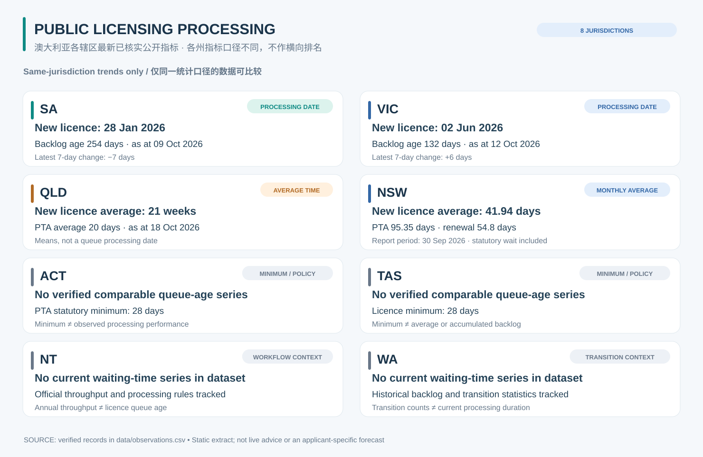

# Australian Firearms Licensing Backlog Tracker
### 澳大利亚枪械许可行政处理进度与积压追踪

**Official sources · Historical evidence · Transparent methodology · Community contributions welcome**  
**官方来源 · 历史证据 · 透明方法 · 欢迎社区贡献**

An evidence-first, cross-jurisdiction public-administration research project following Australian firearms-licensing processing performance, official staffing disclosures, system changes and administrative capacity.

本项目以可核验的官方公开证据为基础，长期记录澳大利亚八个辖区的枪械许可行政办理指标、人员配置、系统改革及积压变化。它不是个人申请进度查询工具，也不会推算任何人的审批日期。

**[Contribute / 参与贡献](CONTRIBUTING.md)** · **[Research prompt / AI 研究提示词](prompts/official-source-contributor.md)** · **[Evidence and calculations / 方法论](analysis/methodology.md)** · **[Jurisdiction sources / 官方来源](analysis/jurisdictions.md)**

## Processing at a glance / 各辖区办理情况



*This is a dated snapshot of the latest **verified records currently committed to this repository**, not live government data. Publication dates differ across jurisdictions. A processing-date backlog age is not an average wait, and a minimum wait is not observed delay.*  
*此图取自仓库现有**已核实并入库**记录，并非政府实时页面。各州数据报告日期不同；“处理日期推算积压年龄”不等于平均等待时间，法定最短等待期也不等于实际积压。*

For source URLs, source wording, evidence paths, exact reporting dates and prior observations, see [data/observations.csv](data/observations.csv) and [evidence/](evidence/). Read the [jurisdiction-by-jurisdiction methodology](analysis/jurisdictions.md) before making comparisons.

可通过 [原始观测数据](data/observations.csv) 和 [按日期保存的证据摘录](evidence/) 查阅官方来源网址、原文、统计日期与历史数据。横向比较前请先阅读[各辖区数据口径](analysis/jurisdictions.md)。

## Staffing and administrative capacity / 人员与行政处理能力


*These are **different official disclosure measures at different dates**: QLD sworn and civilian headcount components; NSW permanent positions, vacancy and proposed recruitment; SA substantive FTE; WA ICT investment (not employees). **Do not add them, rank staffing levels, or interpret them as currently working officers.** Other jurisdictions have no matching verified figures in the dataset.*  
*这些是**不同日期、不同口径**的官方披露：QLD 警务及文职人员组成、NSW 永久岗位/空缺/计划招聘、SA 实质全职当量（FTE），以及 WA 的 ICT 系统投资（并非员工数量）。**不能直接相加、排名或宣称为当前实际在岗警员人数。** 其他辖区尚无相同口径的已核实数值。*

Every displayed numeric source is traceable through [data/staffing.csv](data/staffing.csv), its official URL, and its preserved evidence extract. Read [Staffing and capacity methodology](analysis/staffing-methodology.md) for scope, FTE and headcount distinctions.

每项人数或资金指标均可在 [staffing.csv](data/staffing.csv) 中找到官方链接和证据文件。请参阅[人员与处理能力方法说明](analysis/staffing-methodology.md)，了解实际人数、FTE、编制及招聘公告之间的区别。

## Coverage / 数据覆盖

| Jurisdiction 辖区 | Verified source series currently followed 已记录的主要指标 |
|---|---|
| ACT | Minimum statutory wait; renewal and digital workflow / 最短等待期、续证与数字化流程 |
| NSW | Monthly average times and volume reports; Firearms Registry staffing / 月度平均处理时间、业务量、人员披露 |
| NT | Annual outcomes; licensing processing prerequisites / 年度业务结果与办理前置条件 |
| QLD | Online average processing time; Weapons Licensing staffing / 线上平均处理时间与部门编制 |
| SA | Official processing-date series; substantive firearms-branch FTE / 官方受理日期序列及实质 FTE |
| TAS | Minimum waiting period; forms and staffing context / 最短等待期、表格与人员背景 |
| VIC | Indicative processing-date series / 各类别指示性处理日期 |
| WA | Historical point-in-time backlog; statutory transition and system capacity / 历史积压数量、过渡政策及系统投入 |

Coverage does **not** imply current, equally granular or directly comparable waiting-time data in every jurisdiction. Missing disclosure is labelled as missing; no number is guessed.

“已覆盖”不意味着各州都公开同一口径或同一时间的办理数据。缺失即注明缺失，不会填入猜测值。

## What we measure / 研究什么

- **Official observations / 官方数据** — official police, government, parliamentary, audit and disclosure sources only. / 仅以官方警务、政府、议会、审计及正式信息披露为主要证据。
- **Different metric classes / 不同指标类别** — `processing_date`, `average_processing_days`, `average_processing_weeks`, `backlog_count`, `monthly_count`, `minimum_wait_days`, service standards and policy changes must stay distinct. / 处理日期、平均时间、积压数量、月度统计、最低等待期、服务标准及政策变化不能混为一谈。
- **Trends / 趋势** — same-series differences only, taking the source's own reporting date into account. / 仅比较同一指标序列，并以来源明确的统计日期为准。
- **Capacity / 能力** — distinguish paid/approved positions, headcount, FTE, recruitment and ICT expenditure. / 区分岗位编制、实际人数、FTE、招聘计划及系统投入。
- **Neutral interpretation / 中立分析** — reported queue persistence alone does not establish an intentional delay policy or misconduct. / 持续积压不能单独证明存在故意拖延或不当行为。

For processing-date series, `backlog_age_days = metric_date − processing_date` (calendar days); `speed_ratio = processing_date_advance / elapsed_metric_days`. The status is an interval inference, **not a forecast**. If a metric date and stated source-update date are both unavailable, no backlog-age calculation is made.

处理日期序列计算：积压年龄＝统计日期－当前所处理申请的提交日期（自然日）；推进速度＝处理日期推进天数／统计日期间隔天数。这是对已发生区间的描述，**不是预测**。若统计日期与官方页面更新日期均不可用，不计算积压年龄。

## Contribute evidence / 参与提交官方证据

You can [open an issue](../../issues/new/choose) with an official source even if you cannot edit CSV, or fork the repository and submit a Pull Request. Human maintainers review proposed records before merging. New extracts go to `evidence/<JURISDICTION>/<OBSERVATION_DATE>/` without overwriting historical files.

即使不熟悉 CSV，也可以通过 [Issue](../../issues/new/choose) 提交官方来源；熟悉 GitHub 的贡献者可 Fork 并提交 PR。新证据按观测日期保存，不覆盖旧文件，数据经维护者人工审核后合并。

Read [CONTRIBUTING.md](CONTRIBUTING.md) and use [the standard AI research prompt](prompts/official-source-contributor.md). Before proposing a change:

```bash
python3 scripts/validate_contributions.py
node scripts/generate_readme_visuals.mjs --check
```

Rebuild the homepage charts after approved data changes:

```bash
node scripts/generate_readme_visuals.mjs
```

请先阅读 [贡献规范](CONTRIBUTING.md) 及 [标准 AI Prompt](prompts/official-source-contributor.md)。图表由仓库 CSV 自动生成并可重复验证。数据更新后应重新生成图表并一同提交。

## Files and methods / 数据与方法

| Resource 文件 | Purpose 用途 |
|---|---|
| [data/observations.csv](data/observations.csv) | Processing, legal and workflow observations / 处理、政策及流程观测 |
| [data/staffing.csv](data/staffing.csv) | Distinct staffing/capacity measures / 分口径人员与能力指标 |
| [evidence/](evidence/) | Dated official excerpts / 按日期存档的官方摘录 |
| [analysis/methodology.md](analysis/methodology.md) | Definitions, evidence status and formulas / 定义、核验与计算 |
| [analysis/staffing-methodology.md](analysis/staffing-methodology.md) | FTE/headcount/positions/funding rules / 人员统计口径 |
| [analysis/jurisdictions.md](analysis/jurisdictions.md) | Official source map / 官方数据来源地图 |
| [scripts/analyse.py](scripts/analyse.py) | Processing-date calculations / 处理日期计算 |
| [scripts/generate_readme_visuals.mjs](scripts/generate_readme_visuals.mjs) | Reproducible homepage SVGs / 自动生成首页图表 |
| [docs/pre-publication-review.md](docs/pre-publication-review.md) | Release and privacy review / 公开前审计 |

## Privacy, limitations and reuse / 隐私、局限与再利用

**Never submit** a private applicant's submission date, identity, queue position, licence/application reference, individual estimate, or correspondence. No applicant-specific forecasts, legal advice or inferred misconduct are provided. Figures reflect records in this repository, not necessarily the latest currently displayed government webpage. Official source material remains subject to its original publication and copyright terms.

**禁止提交**私人申请的提交日期、身份、队列位置、证件或申请编号、个人预测及私人通信。本项目不提供个人审批日期预测或法律意见；图表反映仓库已存数据，可能滞后于实时政府页面。官方原始材料仍受其自身发布与版权条件约束。

**Licensing / 开源许可：** Repository code/data licence is under review ahead of public release; do not assume official extracts are licensed for unrestricted redistribution. / 代码与原创数据许可证仍待正式发布前确认；请勿假设官方摘录均允许无限制转载。
