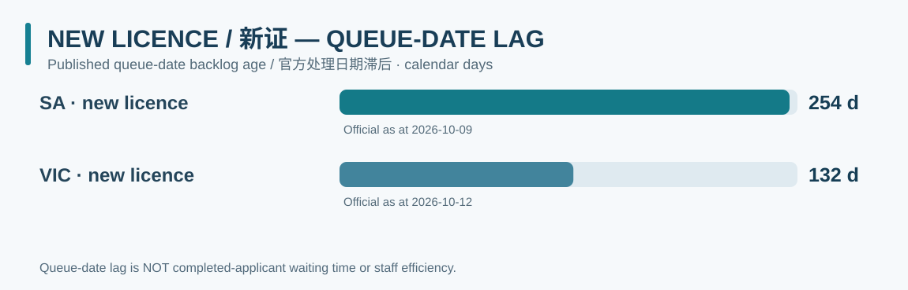

# Australian Firearms Licensing Backlog Tracker
### 澳大利亚枪证行政处理进度与积压追踪

Official-source research into administrative licensing queues, processing performance and staffing across all eight Australian jurisdictions.  
以政府、警方、议会和正式信息披露为证据，记录八个辖区的枪证办理情况、行政积压及人员能力。

### [Explore the website → / 进入在线可视化网站 →](https://kiiiiiingdom.github.io/Australian-firearms-licensing-backlog-tracker/)

**[Interactive national dashboard / 全国交互对比](https://kiiiiiingdom.github.io/Australian-firearms-licensing-backlog-tracker/overview/)** · **[Jurisdiction pages / 八州详情](https://kiiiiiingdom.github.io/Australian-firearms-licensing-backlog-tracker/)** · [Contribution guide / 参与贡献](CONTRIBUTING.md) · [Comparison methodology / 比较方法](docs/methodology/comparison-indices.md)

*The website presents dated, verified official-source snapshots, not live government application tracking. / 网站展示有统计日期的官方来源记录，不是政府实时申请进度查询。*

## New licence queue-date comparison / 新证处理日期积压对比

**The chart measures the gap between an official reporting date and the published application date currently being processed. It is NOT actual completed-case average time or a ranking of police efficiency.**  
**图中衡量的是官方统计日与当前处理申请提交日之间的滞后天数，不是已结案申请平均耗时，更不是警员效率排名。**

[**Explore the interactive national comparison → / 查看全国交互分析 →**](https://kiiiiiingdom.github.io/Australian-firearms-licensing-backlog-tracker/overview/)

## Select a jurisdiction / 选择辖区

| | | | |
|:---:|:---:|:---:|:---:|
| [SA](https://kiiiiiingdom.github.io/Australian-firearms-licensing-backlog-tracker/jurisdictions/SA/) | [VIC](https://kiiiiiingdom.github.io/Australian-firearms-licensing-backlog-tracker/jurisdictions/VIC/) | [NSW](https://kiiiiiingdom.github.io/Australian-firearms-licensing-backlog-tracker/jurisdictions/NSW/) | [QLD](https://kiiiiiingdom.github.io/Australian-firearms-licensing-backlog-tracker/jurisdictions/QLD/) |
| [WA](https://kiiiiiingdom.github.io/Australian-firearms-licensing-backlog-tracker/jurisdictions/WA/) | [TAS](https://kiiiiiingdom.github.io/Australian-firearms-licensing-backlog-tracker/jurisdictions/TAS/) | [ACT](https://kiiiiiingdom.github.io/Australian-firearms-licensing-backlog-tracker/jurisdictions/ACT/) | [NT](https://kiiiiiingdom.github.io/Australian-firearms-licensing-backlog-tracker/jurisdictions/NT/) |

The [live national dashboard](https://kiiiiiingdom.github.io/Australian-firearms-licensing-backlog-tracker/overview/) separates **processing-date age**, **official average processing times**, **within-series trends** and **staffing disclosures**. A selectable reference index = 1.00 is provided for comparable processing-date categories; this is not a single national efficiency score.

[在线全国总览](https://kiiiiiingdom.github.io/Australian-firearms-licensing-backlog-tracker/overview/)将**处理日期积压年龄**、**官方平均处理时间**、**各州自身历史趋势**和**官方人员数据**分别展示。同业务类别内可以选择基准值 1.00，但不将全部州强行转化为统一效率排名。

## Evidence, reproducibility and privacy / 证据、复现与隐私

- Primary evidence comes from Australian government, police, parliament, audit-office, and official disclosure sources. / 只使用官方公开材料核验数据。
- Every verified point links to a dated extract in [evidence/](evidence/) and the structured [observation CSV](data/observations.csv). / 每条已核实记录保留来源、报告日期与历史证据。
- [Staffing measures](data/staffing.csv) distinguish police/civilian headcount, FTE, positions, recruitment and ICT funding. / 人数、FTE、岗位、招聘和 ICT 预算不能混算。
- No personal applicant data, case references, individual queue placement or applicant-specific projections. / 不记录私人申请信息或提供个体审批时间预测。
- The repository is an evidence archive, not a live government feed or legal advice. / 仓库非政府实时系统，也不提供法律意见。

**Contribute:** Read [CONTRIBUTING.md](CONTRIBUTING.md) and the [standard AI research prompt](prompts/official-source-contributor.md). Contributions require independently checkable official sources and human review. / 欢迎以可核实官方来源提交 Issue 或 PR，入库前须人工审核。

**Technical:** This public repository's MkDocs Material site is deployed to [GitHub Pages](https://kiiiiiingdom.github.io/Australian-firearms-licensing-backlog-tracker/) via the [manual Pages workflow](.github/workflows/pages-release.yml). Local preview: `pip install -r requirements-docs.txt && mkdocs serve`. Website figures are dated evidence snapshots, not a live government feed.

**Licensing:** Original repository software is [MIT licensed](LICENSE); the maintainers' original data compilation and charts are offered under [CC BY 4.0](DATA-LICENSE.md), to the extent rights are owned. This does **not** relicense third-party official excerpts. Citation metadata: [CITATION.cff](CITATION.cff).

**Publication:** Repository is **PUBLIC**, the `main` protection ruleset is active, and the [website is published](https://kiiiiiingdom.github.io/Australian-firearms-licensing-backlog-tracker/). [Third-party source rights](docs/source-rights-register.md) still require document-specific review. / 仓库及网站已公开、主分支保护生效；第三方官方原始资料的具体转载条件仍须逐份核查。
