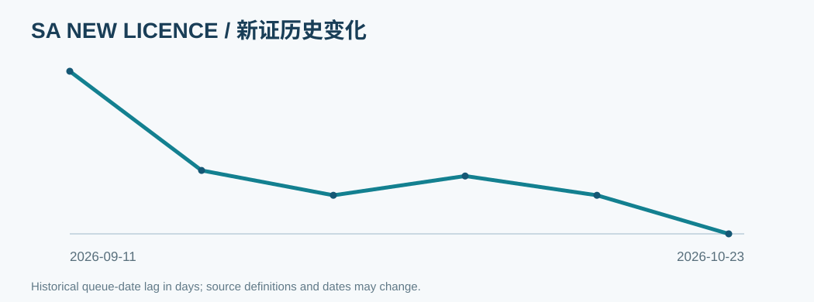

# SA · South Australia

**Official verified records / 官方已核实数据**  
This is a published-data snapshot, **not** an individual licence application forecast. / 仅记录公开行政数据，不预测个人审批时间。

[← National dashboard / 返回全国总览](../overview.md)

## Latest published series / 最新入库指标

| Series / 指标 | Type / 口径 | Official value / 官方数值 | As at / 统计日期 | Evidence / 证据 |
|---|---|---|---|---|
| `firearms_licence_application` | `processing_date` | processing 2026-01-28 · 254 d queue-date lag | 2026-10-09 | [official source](https://www.police.sa.gov.au/services-and-events/firearms-and-weapons/status-of-my-application) · [evidence](https://github.com/kiiiiiingdom/Australian-firearms-licensing-backlog-tracker/blob/main/evidence/SA/2026-10-09/source.txt) |
| `firearms_licence_renewal` | `processing_date` | processing 2026-08-21 · 49 d queue-date lag | 2026-10-09 | [official source](https://www.police.sa.gov.au/services-and-events/firearms-and-weapons/status-of-my-application) · [evidence](https://github.com/kiiiiiingdom/Australian-firearms-licensing-backlog-tracker/blob/main/evidence/SA/2026-10-09/source.txt) |
| `permit_to_acquire` | `processing_date` | processing 2026-08-26 · 44 d queue-date lag | 2026-10-09 | [official source](https://www.police.sa.gov.au/services-and-events/firearms-and-weapons/status-of-my-application) · [evidence](https://github.com/kiiiiiingdom/Australian-firearms-licensing-backlog-tracker/blob/main/evidence/SA/2026-10-09/source.txt) |
| `firearms_licence_backlog` | `backlog_count` | 1792 applications | 2025-11-14 | [official source](https://www.police.sa.gov.au/__data/assets/pdf_file/0006/1427136/Determination-26-1387.pdf) · [evidence](https://github.com/kiiiiiingdom/Australian-firearms-licensing-backlog-tracker/blob/main/evidence/SA/2025-11-14/foi-26-1387.txt) |
| `firearms_licence_oldest_awaiting` | `processing_date` | processing 2025-02-17 · 270 d queue-date lag | 2025-11-14 | [official source](https://www.police.sa.gov.au/__data/assets/pdf_file/0006/1427136/Determination-26-1387.pdf) · [evidence](https://github.com/kiiiiiingdom/Australian-firearms-licensing-backlog-tracker/blob/main/evidence/SA/2025-11-14/foi-26-1387.txt) |
| `firearms_licence_renewal_backlog` | `backlog_count` | 4195 applications | 2025-11-14 | [official source](https://www.police.sa.gov.au/__data/assets/pdf_file/0007/1437406/Determination-26-1424.pdf) · [evidence](https://github.com/kiiiiiingdom/Australian-firearms-licensing-backlog-tracker/blob/main/evidence/SA/2026-04-14/foi-26-1424.txt) |
| `permit_to_acquire_backlog` | `backlog_count` | 2192 applications | 2025-11-14 | [official source](https://www.police.sa.gov.au/__data/assets/pdf_file/0007/1437406/Determination-26-1424.pdf) · [evidence](https://github.com/kiiiiiingdom/Australian-firearms-licensing-backlog-tracker/blob/main/evidence/SA/2026-04-14/foi-26-1424.txt) |

## Trend / 历史趋势

## Staffing and administrative context / 人员与行政背景

| Official measure / 口径 | Value / 数值 | As at | Source / 来源 |
|---|---|---|---|
| `fte` | fte: 17.8 | 2026-04-14 | [official source](https://www.police.sa.gov.au/__data/assets/pdf_file/0007/1437406/Determination-26-1424.pdf) · [evidence](https://github.com/kiiiiiingdom/Australian-firearms-licensing-backlog-tracker/blob/main/evidence/SA/staffing/2026-04-14/source.txt) |

## Data limitations / 数据局限

- Statistics use the official source's own date and type; data may be historical. / 数据使用官方原始统计日期和定义，可能具有滞后性。
- Counts, legal minimum waits and staffing posts are never substituted for queue age. / 不把人数、最低等待期或岗位编制等同于积压年龄。
- Missing public statistics are not zero. / 未公开不等于零。

[Raw observations](https://github.com/kiiiiiingdom/Australian-firearms-licensing-backlog-tracker/blob/main/data/observations.csv) · [Evidence archive](https://github.com/kiiiiiingdom/Australian-firearms-licensing-backlog-tracker/tree/main/evidence/SA)
