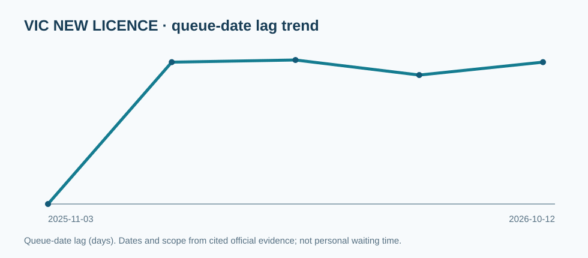

# VIC · Victoria

**Official verified records / 官方已核实数据**  
This is a published-data snapshot, **not** an individual licence application forecast. / 仅记录公开行政数据，不预测个人审批时间。

[← National dashboard / 返回全国总览](../overview.md)

## Latest published series / 最新入库指标

| Series / 指标 | Type / 口径 | Official value / 官方数值 | As at / 统计日期 | Evidence / 证据 |
|---|---|---|---|---|
| `new_firearm_licence_application` | `processing_date` | processing 2026-06-02 · 132 d queue-date lag | 2026-10-12 | [official source](https://www.police.vic.gov.au/firearms-licensing) · [evidence](https://github.com/kiiiiiingdom/Australian-firearms-licensing-backlog-tracker/blob/main/evidence/VIC/2026-10-12/source.txt) |
| `firearm_licence_renewal_application` | `processing_date` | processing 2026-07-31 · 73 d queue-date lag | 2026-10-12 | [official source](https://www.police.vic.gov.au/firearms-licensing) · [evidence](https://github.com/kiiiiiingdom/Australian-firearms-licensing-backlog-tracker/blob/main/evidence/VIC/2026-10-12/source.txt) |
| `online_permit_to_acquire` | `processing_date` | processing 2026-09-28 · 14 d queue-date lag | 2026-10-12 | [official source](https://www.police.vic.gov.au/firearms-licensing) · [evidence](https://github.com/kiiiiiingdom/Australian-firearms-licensing-backlog-tracker/blob/main/evidence/VIC/2026-10-12/source.txt) |
| `manual_permit_to_acquire` | `processing_date` | processing 2026-09-28 · 14 d queue-date lag | 2026-10-12 | [official source](https://www.police.vic.gov.au/firearms-licensing) · [evidence](https://github.com/kiiiiiingdom/Australian-firearms-licensing-backlog-tracker/blob/main/evidence/VIC/2026-10-12/source.txt) |
| `import_permit` | `processing_date` | processing 2026-10-01 · 11 d queue-date lag | 2026-10-12 | [official source](https://www.police.vic.gov.au/firearms-licensing) · [evidence](https://github.com/kiiiiiingdom/Australian-firearms-licensing-backlog-tracker/blob/main/evidence/VIC/2026-10-12/source.txt) |

## Trend / 历史趋势

## Staffing and administrative context / 人员与行政背景

No verified quantitative staffing entry currently in this repository. / 仓库暂无已核实的同口径人员数值。

## Data limitations / 数据局限

- Statistics use the official source's own date and type; data may be historical. / 数据使用官方原始统计日期和定义，可能具有滞后性。
- Counts, legal minimum waits and staffing posts are never substituted for queue age. / 不把人数、最低等待期或岗位编制等同于积压年龄。
- Missing public statistics are not zero. / 未公开不等于零。

[Raw observations](https://github.com/kiiiiiingdom/Australian-firearms-licensing-backlog-tracker/blob/main/data/observations.csv) · [Evidence archive](https://github.com/kiiiiiingdom/Australian-firearms-licensing-backlog-tracker/tree/main/evidence/VIC)
