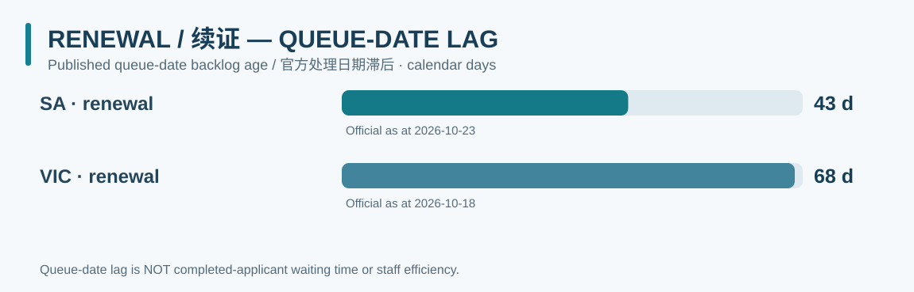
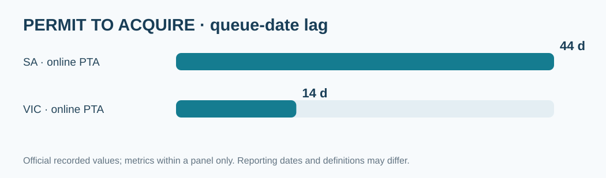
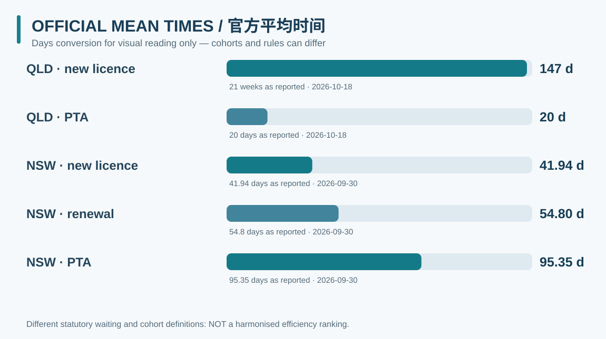
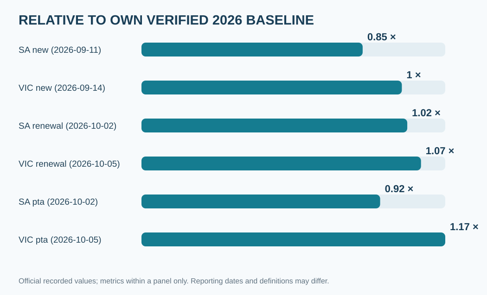
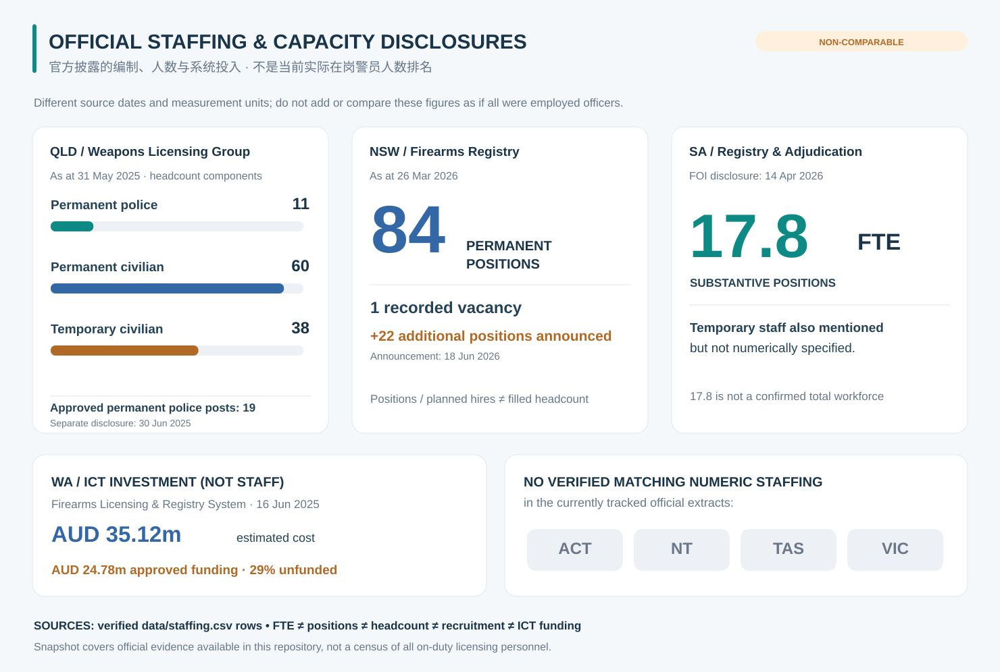

# National dashboard / 全国总览

**Verified repository snapshots; NOT live government data or individual application forecasts.**  
**以下为仓库已核实记录，不是实时政府数据，也不提供个人审批预测。**

<a href="jurisdictions/SA/">South Australia</a><a href="jurisdictions/VIC/">Victoria</a><a href="methodology/comparison-indices/" class="secondary">Comparison rules / 比较方法</a>

## Published queue-date backlog age / 处理日期积压年龄

These are categories, not a pooled cross-state efficiency ranking. Published as-at dates differ. / 仅在业务类别内描述公开处理日期滞后，且各州统计日并非完全相同。

### New licence / 新证

### Renewal / 续证

### Permit to acquire / PTA

## Select reference = 1.00 / 自选相对基准 1.00

The selectable reference index compares **published queue-date ages**, not officer productivity or actual individual wait durations. / 指数只表示官方公布处理日期的相对滞后，不代表警员效率或个人办理时间。

Loading verified records / 加载已核实数据…

## Average time series / 官方平均办理时间

QLD online averages and NSW registry averages have different definitions and possible statutory waiting inclusions. We convert weeks to days only for **visual scale**, not a harmonised performance index. / 单位换算只是方便阅读，绝不据此给警方效率排名。

## Own-history change / 各序列自身变化

Each series uses its own earliest verified positive backlog-age point since September 2026 as 1.00; periods differ. / 每个序列分别以其 2026 年 9 月以来最早有效已核实值为 1.00 基准，无法视为相同起点的横向实验。

## Staff and administrative resources / 官方人员及处理能力

[Official staffing CSV](https://github.com/kiiiiiingdom/Australian-firearms-licensing-backlog-tracker/blob/main/data/staffing.csv) · [Staffing scope method](https://github.com/kiiiiiingdom/Australian-firearms-licensing-backlog-tracker/blob/main/analysis/staffing-methodology.md)

## Other jurisdictions / 无连续可比指标的辖区

ACT, NT, TAS and WA currently hold official workflow, statutory or historical observations without a continuous comparable current processing-date series. Missing values do not mean zero backlog. / 缺少连续数据不代表不存在积压。

[ACT](jurisdictions/ACT.md) · [NT](jurisdictions/NT.md) · [TAS](jurisdictions/TAS.md) · [WA](jurisdictions/WA.md) · [Methodology](methodology/comparison-indices.md)
